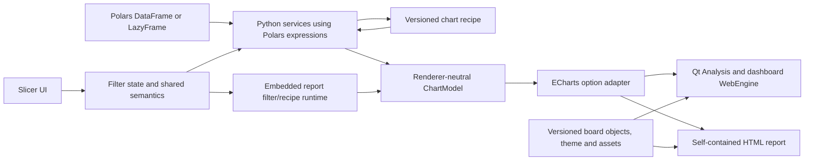

# Lytrize: Apache ECharts and Polars migration plan

**Status (2026-10-19):** Plotly is removed from the active runtime and dependencies; native Analysis, dashboard, and HTML export paths use ChartModels and Apache ECharts. Polars-backed analysis and KPI code exists, while pandas remains the active session/UI dataframe for compatibility. Code-level fixes for legend placement, chart typography/contrast, map density visibility, Analysis tab settings, and chart-switch redraw cost are implemented; visual/runtime acceptance remains open.  
**Scope:** migrate the visualization layer from Plotly to Apache ECharts and the dataframe compute layer from pandas to Polars.  
**Recommendation:** keep the current Qt/Python application and use Polars through its Python API first. Polars executes native expressions in its Rust engine; this does not require a rewrite of Lytrize’s services, UI, or session orchestration in Rust.

## Implementation status

### Renderer cutover and current status (2026-10-19)

- Active analysis dispatch now routes the chart families through `polars_chart_service` and returns semantic ChartModels. Qt chart cards and the report canvas render those models through the local ECharts runtime.
- Dashboard HTML generation serializes the BoardModel through `backend/modules/echarts_export.py:board_to_html`; chart, KPI, slicer, text, image, card style, and background objects share that board representation. The Analysis/dashboard ECharts paths are implemented, but visual acceptance of editing, preview, resize, slicer, and export behavior remains open.
- Session persistence writes native chart models. Historical `fig_json` is parsed as inert JSON and passed to `legacy_plotly_adapter` for supported-family conversion; the reader imports no Plotly code. Unsupported historical figures are skipped with diagnostics rather than executed.
- Removed Plotly from `requirements.txt` and the `run_dev.sh` dependency check. Debian and RPM package descriptions now name Apache ECharts. Active chart hosts and export paths use ECharts; the legacy adapter remains only to read supported old figure JSON.
- Plotly is no longer an active runtime dependency. The adapter is retained only for reading supported older saved sessions; remaining Plotly mentions are historical comments or archived material. Static syntax checks have run for the recent code fixes, but the application has not been launched for UI verification.

The active app does not require Plotly to launch. Remaining Plotly-named code is a JSON-only reader for older saved figures plus historical comments and archived files; it is not a chart rendering fallback. Outstanding work concerns old-session conversion coverage, broader Polars adoption, backup/restore guarantees, and functional parity validation.

- **Phase 1 foundation:** `backend/modules/board_model.py` defines typed chart/KPI/slicer/text/image board objects, logical geometry, shared style/background metadata, validation, and deterministic serialization. `backend/modules/chart_model.py` defines validated semantic ChartModel v1 data, recipe, display, and source fields.
- **Polars pilot:** `backend/services/polars_engine.py` provides lazy CSV loading with stable source row IDs and content revision, schema roles, slicer filtering, numeric expressions, calendar comparisons, preset KPI calculations, and grouped chart-model generation. The active session still keeps pandas data for UI compatibility, and XLSX import remains pandas-backed; CSV therefore loads through both paths. `session_bundle.py` has opt-in content-addressed Parquet helpers. Polars 1.44.2 is pinned. Canonical Polars session ownership, semantic parity, and performance gates remain open.
- **Native Analysis routes:** The listed analysis families, including all Map Plot modes, have Polars-backed builders and native ChartModel/ECharts rendering routes. Map Plot uses bundled Natural Earth geometry for country choropleths, supported US-state choropleths, offline coordinate/location scatter, bounded sampling, and lossless spatial density cells. Outlier/Data Quality semantics and map appearance still need behavioral and visual verification. Pivot Table and Descriptive Statistics use virtualized Qt tables and aggregated static HTML export. Live display settings edit native ChartModels directly. `chart_service.py` persists ChartModels as versioned JSON, and `database.get_session_charts` restores them. Historical Plotly figures are handled by a JSON-only migration reader; the active dashboard export does not convert native models back to Plotly.
- **Outlier and Data Quality implementation cut (verification pending):** `backend/services/polars_chart_service.py` now computes IQR fences and exact snapshot row IDs in Polars, builds bounded ECharts scatter models, and builds native missing-summary, missing-pattern heatmap, and duplicate-summary models. `backend/modules/analysis/outlier.py` keeps a temporary pandas boundary while exposing stable row-ID deletion; `OutlierTab` renders ECharts models and applies deletion by row ID. `DataQualityTab` renders ECharts models, and the Analysis worker and slicer recipe path can regenerate native Outlier/Data Quality models. The existing data-cleaning helpers and the wider panel still use pandas and remain in the data-tool migration phase. No visual or behavioral validation has been run for this cut yet.
- **Native renderer and recent Analysis fixes (2026-10-19):** Apache ECharts 6.1.0 is vendored under `backend/assets/echarts/` with license/notice files and checksum. The local Qt host, shared adapter, ChartCard route, BoardModel-based dashboard export, and static single-chart/board export are implemented. The adapter now maps legend positions/orientations explicitly, applies value-label and tooltip typography with automatic light/dark contrast, and renders density cells as graduated geographic points to avoid the blank heat layer reported in the UI. Analysis chart-tab selection now recovers settings from the ChartModel recipe when bridge metadata is missing. Analysis-type switching reuses unchanged models to avoid unnecessary validation and redraw. These are code changes only; no app launch or visual acceptance has confirmed the reported fixes.
- **Still outstanding:** SessionManager and XLSX ingestion remain pandas-backed; CSV is parsed for both Polars and pandas consumers. Outlier/Data Quality behavior, map rendering, legend/layout, typography, chart-settings selection, and switch responsiveness need UI acceptance. Dashboard object workflows, interactive slicer/report parity, live KPI refresh, complete backup/restore, old-session conversion coverage, and performance measurement remain open. Plotly is not an active app dependency or renderer.

## Remaining migration backlog — current implementation paths

This checklist is the active completion record. A route is complete only when its normal UI path, regeneration/filter path, saved-session path, dashboard/export path, and compatibility behavior use the new contract. Code implementation and runtime acceptance are tracked separately. Plotly runtime retirement is complete; remaining legacy JSON conversion is tracked under persistence. Keep the pandas/session migration, compatibility, and verification work in scope until it is safe to remove pandas from active paths.

Sections 1–5 retain some of the original migration rationale and target-state detail. For current implementation status, use the dated status above and this backlog; where older explanatory text describes Plotly as active, the status above takes precedence.

### A. Finish Analysis and data-tool chart families

- [x] **Map Plot — native offline generation and portability implemented; visual acceptance pending:** `build_map_plot_chart()` and `build_choropleth_chart()` aggregate with Polars and emit ChartModels for choropleth, coordinate/location scatter, bounded sampling, and density aggregation. Country/admin-1 geometry, offline map assets, attribution, checksums, refresh tooling, and HTML embedding are implemented. On 2026-10-19 the ECharts density rendering was changed from geo heatmap to graduated geographic scatter because the preview showed only its color scale. Static syntax checks pass; map visibility and behavior still require UI/runtime verification.
- [ ] **Outlier analysis and row actions — code cut in place, verification open:** Polars quantiles/fences, snapshot row IDs, ECharts scatter models, and DataTools row deletion are implemented. Verify IQR/null semantics, row-action behavior after filtering/reordering, saved-session behavior, and slicer regeneration before closing this item.
- [ ] **Data Quality — code cut in place, verification open:** Native Polars missing counts/percentages, bounded missing-pattern heatmap, duplicate-excess semantics, no-issues state, ECharts DataTools rendering, Analysis worker route, and slicer recipe regeneration are implemented. Verify null/NaN/duplicate semantics and view behavior. Data-cleaning actions remain separate and their computations still need migration under the Polars service work below.
- [x] **Analysis dispatch and chart builders:** `analysis_service.run_analysis()` and `desktop/workers.py` route supported chart families through Polars builders and return ChartModels. A source scan found no Plotly imports or figure construction in the active Analysis builders. Behavioral, saved-session, and slicer-recipe parity remains open under section H.
- [x] **Analysis regeneration:** Native chart recipes rebuild through `backend/services/chart_service.py` and Polars builders while retaining model identity and saved display settings. Historical figure JSON conversion remains a compatibility path.
- [ ] **Internal route audit:** Confirm every internal-only Analysis/DataTools route and saved-recipe case has a native builder or an explicit unsupported-state message; keep the JSON-only old-session converter separate from active rendering.

### B. Remove Plotly from Analysis cards and display behavior

- [x] **ChartCard ECharts route:** Native Analysis chart models render through the shared ECharts/native-table views without Plotly rendering widgets. Older figure JSON is converted at the input boundary. Card actions and lifecycle checks remain under section H.
- [ ] Complete renderer-neutral display/style parity across `backend/chart_display.py`, `chart_style.py`, settings panels, and the ECharts adapter. Legend anchor/orientation mapping, automatic label/tooltip contrast, typography controls, and chart-tab settings restoration were updated on 2026-10-19; supplied screenshot behavior is not yet visually verified.
- [x] **Per-chart settings and switching code fix (2026-10-19):** Selecting a chart tab now restores that chart’s config/layout/typography from metadata or its ChartModel recipe; analysis-type changes reuse unchanged chart models to avoid extra conversion/redraw. UI verification for settings accuracy and perceived switch latency remains open under section H.
- [ ] Complete the responsive layout contract: actual-container sizing, one-line/scroll legend policy, title/card-edge spacing, axis/colorbar reservations, pie outside-label collision handling, compact-card fallback, and re-layout after resize/font/data/theme changes. Legend position/orientation mapping is implemented; overlap and fit acceptance for the supplied screenshots remains open.
- [ ] Preserve chart-level features across the ECharts route: tooltip content/formatting, legend click/selection, series ordering and visibility, value labels, palettes, axes/dual axes, annotations and trendlines, chart background/transparency, PNG capture, and any currently offered modebar/export actions. Document controls that do not have equivalent behavior and migrate their saved settings deliberately.

### C. Replace dashboard and report renderer paths

- [x] **Dashboard rendering/export route:** `dashboard_page.py` and `report_canvas.py` use the ECharts-backed report surface, and `echarts_export.board_to_html()` serializes BoardModel objects. There is no active Plotly rendering dependency. Remaining object-editing, resize/drag, preview, save/reopen, slicer, and export acceptance is tracked below and in section H.
- [ ] Make the object model in `backend/modules/board_model.py` the persisted/editor contract for chart, KPI, slicer, text, and image objects. Connect actual creation/edit/delete/reorder/resize/selection and per-object style workflows; use stable object IDs rather than positional KPI/slicer indexes, while reading and converting existing index-based layouts.
- [ ] Remove the automatically attached chart analysis-note box from report markup/editor behavior. Migrate existing non-empty notes to independent text objects with stable IDs and their own geometry/style; preserve empty-note behavior without reserving chart space.
- [ ] Complete first-class image objects and existing image support: dashboard background image, card image/grouped card image, opacity/blend, path or embedded asset references, resize/crop/layer ordering, missing-asset handling, package/export inclusion, and backup/restore. Keep local files local by default; make any external asset embedding explicit.
- [ ] Keep KPI cards and slicers as first-class board objects with their current styling, labels, formatting, and layout. Verify card/background/title/image styling is applied identically in edit mode, preview, saved reopen, and exported HTML.

### D. Migrate slicer and KPI interaction paths

- [ ] Complete interactive report slicer behavior using typed object/chart events and ChartModel updates. The normal board export currently represents slicer values as snapshots; porting live filter/recipe recomputation and validating report-vs-chart scope remains open.
- [ ] Make live dashboard filtering use the canonical Polars dataset and stable row IDs instead of pandas `DataFrame` filtering in `desktop/pages/dashboard_page.py` and `backend/services/slicer_service.py`. Rebuild only affected chart recipes and keep their chart/object UIDs, styles, and geometry stable.
- [ ] Connect the Polars KPI implementations in `backend/services/kpi_service.py` to the live dashboard refresh and `desktop/widgets/kpi_dialog.py`. Verify all 20 registered KPI types, custom arithmetic grammar, date/period comparisons, null/NaN/zero behavior, category ties/order, formatting, stale-column states, and refresh on data revision/slicer changes.
- [ ] Port the standalone report’s JavaScript filter/recipe semantics to ChartModel/ECharts and compare them with the Python/Polars result for the same fixtures. Define an explicit report data payload and export notice for interactive slicers; static exports should not include filterable row data.

### E. Canonical Polars data and data-tool migration

- [ ] Make Polars the canonical active dataset in `SessionManager` / `desktop/session_bridge.py`; stop loading each CSV into both Polars and pandas. Define one schema, stable row-ID, source revision, row order, null/NaN, date/time, and user-classified column-role policy.
- [ ] Replace pandas dependencies in CSV/XLSX/parquet ingestion, session state, column roles, preview/table access, filtering, transforms, cleaning, duplicate/missing handling, and report payload creation. Keep Excel support and formula/sheet behavior; remove pandas only after readers and downstream consumers use Polars or narrow Arrow/NumPy boundaries.
- [ ] Migrate `desktop/widgets/data_tools_panel.py`, `backend/services/transform_service.py`, `backend/services/filter_service.py`, role detection, data validation, and row deletion/edit flows. Preserve regex/date behavior or define a documented supported subset/fallback; preserve row identities across sorting, filtering, transform, and deletion.
- [ ] Audit all remaining pandas imports and pandas-shaped operations in `backend/` and `desktop/`; classify each as active, bounded compatibility reader, optional library interop, or dead code. Remove active round-trips and whole-frame conversions, not just direct imports. Measure conversion cost where a temporary boundary remains.
- [ ] Resolve the installed dependency set after the audit: remove pandas if no active feature needs it; retain `openpyxl` only if XLSX import still uses it; retain NumPy/SciPy/pyarrow/pycountry only for documented active uses. Do not remove a package based only on the main Analysis path.

### F. Persistence, saved-session migration, and complete backup/restore

- [ ] Make ChartModel JSON/recipe the active write format in `backend/services/chart_service.py`, `backend/modules/database.py`, and session persistence; remove active `plotly.io` serialization/deserialization and `fig_json` writes. Keep versioned legacy readers only for the defined migration window.
- [ ] Resolve every existing saved `fig_json` case: rerun from a valid stored recipe and source dataset when possible; otherwise convert only supported Plotly traces/layouts with a loss report or preserve a static image. Never silently drop charts, notes, styles, or geometry. Store conversion diagnostics and make migrations idempotent.
- [ ] Complete schema/version handling for ChartModel, BoardModel, KPI/slicer/text/image IDs, geometry, display settings, dataset engine/revision, and local asset references. Preserve old drafts and current session keys during upgrade.
- [ ] Complete portable backup and restore using `backend/services/session_bundle.py`, database/session services, and dashboard asset handling. Verify dataset and image inclusion, content hashes, offline portability, old JSON backup import, restore to a clean profile, and repeat restore without duplication.

### G. ECharts exports, local assets, and packaging

- [x] Move the normal dashboard/report export path to `backend/modules/echarts_export.py`; native model export uses ECharts and does not pass through the legacy reader. Preserve title, canvas geometry, card styling, notes-to-text conversion, KPIs, slicers, images, table rendering, and report metadata.
- [ ] Finish standalone export modes: static self-contained sharing; interactive self-contained sharing with an explicit data-inclusion summary; image/table asset packaging; offline runtime/fonts; filter interaction parity; and documented limits for unsupported features. No CDN or mandatory network request.
- [ ] Audit local ECharts/map/font/license assets and packaging in `build_deb.sh`, `build_rpm.sh`, `rpm_packaging/lytrize.spec`, `run_dev.sh`, and `requirements.txt`. Keep ECharts version and checksum/license notices in source and packages; remove stale Plotly references from active comments/docs after confirming the JSON-only compatibility reader remains the only current-code reference.
- [ ] Check old frontend CSS/selectors and docs for Plotly-only remnants, including `backend/assets/styles.css`, generated report markup, and legacy report controls. Delete dead runtime files only after import/reference searches show no callers.

### H. Verification and release gates

- [ ] Build differential fixtures for each chart family, KPI, filter type/scope, old session/backup version, image asset case, and the supplied legend/overlap screenshots. Compare numerical results, labels/order, null and date behavior, output object identity, and saved/reopened geometry.
- [ ] Verify Analysis, dashboard edit, preview, save/reopen, slicer updates, KPI refresh, static/interactive HTML, PNG, and complete backup/restore on the same representative datasets. Exercise offline behavior, missing geometry/assets, narrow cards, large tables, and removed/renamed columns.
- [ ] Run static import/DOM/persistence/dependency audits and the requested functional/UI checks; record results and unresolved parity gaps here. Measure startup/package size, peak memory, import/filter/KPI/chart update latency, export size, and responsiveness against the current implementation.
- [x] Remove `plotly` from `requirements.txt`, `run_dev.sh`, active Python imports, Linux package metadata, PlotlyWebView/PlotlyView, and active report paths. The JSON-only legacy reader remains for old saved sessions and does not require the package. Remove pandas from runtime dependencies only after the canonical Polars and XLSX/session paths clear the equivalent audit.

#### Current Plotly runtime inventory

The current app runtime has no Plotly imports, calls, or package requirement. `backend/modules/legacy_plotly_adapter.py` and the legacy `fig_json` branch in `backend/services/chart_service.py` accept JSON data only to migrate supported old sessions into ChartModels. Remaining textual Plotly references in source comments, CSS for the retired Streamlit app, and old smoke/verification scripts are historical and are not imported by `desktop/app.py`. The `Old codebase (Do not delete)/` directory is archival and still contains the original Plotly application; it is not an active app path. Re-run a repository-wide import search if archive directories are ever brought back into the build.

## 1. Executive recommendation

Lytrize is a native PySide6/Qt desktop application with QWebEngine-based chart and report surfaces. The active Analysis and dashboard renderers use Apache ECharts with semantic ChartModels and BoardModels. Plotly is absent from runtime dependencies and active chart rendering; a JSON-only converter remains for supported historical `fig_json` sessions. The remaining migration is focused on Polars becoming the canonical session dataframe, feature/interaction parity, old-session coverage, backup/restore, and visual/performance acceptance.

The migration should establish renderer-independent chart and dataframe contracts first. Python services should orchestrate work while Polars performs dataframe operations; ECharts should render a structured chart model produced by that data layer. The interactive, self-contained HTML report will need a carefully specified JavaScript implementation of the same recipe/filter semantics, because an exported HTML file cannot call the Python process.

Nearly all dataframe-native operations in this product are technically expressible in Polars. A rough planning estimate is that 85–95% of current dataframe transformations and calculations can move to Polars expressions. This is not an audited estimate of source lines or engineering effort: a code scan found direct pandas imports across 37 files under `backend/` and `desktop/`, and those files vary greatly in complexity. The hard part is preserving behavior around row identity/order, nulls, data types, date parsing, and UI access—not whether Polars can calculate a sum, group, period comparison, or window.

All 20 registered preset KPI types appear implementable in Polars. Keep the custom formula feature constrained to its current safe arithmetic grammar and compile its parsed AST to Polars expressions. Do not use per-row Python UDFs as a substitute for native expressions. Retain Python for Qt, product rules, chart-model construction, and workflow orchestration; convert selected columns to NumPy only for specialized numerical routines.

Keep ECharts, its selected map geometry, and fonts as local assets. Do not use a CDN or make ECharts options from arbitrary saved JavaScript. This supports privacy, deterministic offline behavior, and universal sharing. A report that offers live slicers must still embed the relevant data columns and rows; make that data inclusion explicit to the person exporting it. Provide a static, data-free report mode as well as an interactive, self-contained mode.

The current chart legend issue should be treated as a layout-engine requirement in its own right. Switching libraries does not guarantee that a horizontal legend stays on one row or that pie labels stop overlapping. The new renderer must measure the real chart container and apply a documented fit policy for title, plot, legend, axes, and outside labels. If the card is too narrow for all legend items, use a one-line scrollable legend or a side legend according to the selected policy; never allow an unbounded wrapped legend to cover the plot or labels.

### Decisions guiding implementation

| Decision | Recommendation | Why |
|---|---|---|
| Scope of first release | Replace rendering and persisted chart contract; keep the Qt app and migrate dataframe compute incrementally | Preserves product behavior while replacing the engines behind it |
| Data engine | Make Polars the canonical dataframe engine through Python; use lazy queries where useful and materialize at UI/chart boundaries | Gets Rust-backed dataframe compute without introducing a second backend service or rewriting Qt |
| Rust strategy | Defer a direct Rust application/service rewrite until profiling shows a need that Polars cannot address | Polars already runs its expression engine in Rust; rewriting orchestration now adds a separate migration without fixing renderer/data semantics |
| Canonical saved chart | Versioned recipe plus renderer-neutral chart model; never persist ECharts instance internals as the only chart meaning | Enables re-rendering, filtering, future renderer changes, and backups |
| Qt and HTML renderers | One shared local ECharts runtime and option adapter, with thin host bridges | Prevents visual and interaction drift between Analysis, Dashboard, Preview, and export |
| Slicers | Keep Python filter services authoritative in the app; define and parity-check the embedded JavaScript recipe/filter contract for standalone HTML | Offline HTML cannot call Python, but must preserve the same results |
| Text and notes | Remove the empty per-chart “Add analysis notes…” editor and automatic note area; introduce independent text objects on the dashboard | Text should have its own identity, layout, styling, and export lifecycle |
| Images | Preserve background/card image support; add a first-class image object on the canvas | Current image support is a background treatment, not a movable image tile |
| Maps | Bundle documented local GeoJSON/map assets and make external map access opt-in | Existing map modes can request online tiles; that conflicts with private/offline defaults |
| Plotly retirement | Keep a temporary migration/rollback path; remove the runtime and Python dependency only after saved sessions and exports have a defined conversion path | Saved `fig_json` values are Plotly-specific and cannot be read by ECharts |

## 2. What the codebase does today

### 2.1 Application structure

| Area | Current implementation | Migration consequence |
|---|---|---|
| Application entry | `desktop/app.py`, `desktop/main_window.py` | Keep the native Linux/Qt app and its navigation/pages |
| Data and analysis | pandas-backed session plus Polars services in `backend/services/analysis_service.py` and `polars_chart_service.py` | Make Polars canonical across session, UI, transforms, filters, and data tools; preserve semantics and row IDs |
| Chart recipe | `backend/modules/chart_model.py`, `board_model.py`, and `backend/services/chart_service.py` | Maintain versioned renderer-neutral model and recipe compatibility, including supported old `fig_json` conversion |
| Analysis chart host | `desktop/widgets/chart_card.py` and `desktop/widgets/echarts_web_view.py` | ECharts/native-table host is implemented; verify settings binding, view lifecycle, rendering, and resize behavior |
| Dashboard/editor | `desktop/pages/dashboard_page.py`, `desktop/widgets/report_canvas.py`, `backend/modules/report_editor.py` | ECharts-backed BoardModel canvas/export path is implemented; complete interaction and persistence acceptance for geometry, selection, and bridge workflows |
| HTML report generation | `backend/modules/echarts_export.py` | Preserve static self-contained ECharts output; complete interactive report modes and data disclosure policy |
| Slicers and filtering | `backend/services/slicer_service.py`, `backend/services/filter_service.py`, board export | Keep filter algebra and report-vs-chart scope; complete live exported-report filtering and verify parity with desktop Polars results |
| KPI calculations | `backend/services/kpi_service.py`, `desktop/widgets/kpi_dialog.py` | Keep the Python service/result API and move dataframe calculations to Polars expressions; preserve live recomputation and stable KPI identity |
| Session data | `backend/services/session_bundle.py`, `backend/modules/database.py`, `desktop/session_bridge.py` | Preserve content-addressed Parquet storage and draft restore; version/migrate chart, text, image, geometry, and dataframe state |
| Build/runtime | `requirements.txt`, `run_dev.sh`, `build_deb.sh`, `build_rpm.sh`, `rpm_packaging/lytrize.spec` | Local ECharts assets and Plotly dependency retirement are implemented; finish asset/package audit and remove pandas only after active ingestion/session/UI paths migrate |

The `Old codebase(Do not delete)/` folder contains earlier Streamlit-era material. It is useful history but should not drive the design of the current desktop application. The root/current runtime files and actual call sites are the source of truth for migration.

### 2.2 Chart families and current behavior to preserve

The user-facing Analysis picker currently includes descriptive summary, statistical, distribution, correlation, categorical bar, pie/donut, time series, scatter, matrix heatmap, pivot table, and map. The service registry also contains outlier and data-quality runners, so the migration inventory must include those even if they are not exposed in the main picker in every page/context.

| Existing family | Current meaning/features to preserve | ECharts-side direction |
|---|---|---|
| Descriptive summary | Summary-statistics table | Keep as a native Qt/report table; it does not need to become an ECharts chart |
| Statistical | Grouped summary values, bars, selected palette/labels | ECharts `bar` series with category/value axes |
| Distribution | Histogram/bin settings, optional grouping, box plot | Aggregate histogram bins in Python for parity; ECharts `bar`; compute quartiles/outliers and render ECharts `boxplot` |
| Correlation | Correlation matrix and continuous color scale | ECharts `heatmap`, labels, visual map, missing-value handling |
| Categorical bar | Multiple dimensions/measures, aggregation, sort/top-N, horizontal/vertical, grouped/stacked/relative, dual axis, labels | ECharts `bar`, `grid`, category/value axes, optional second value axis; preserve aggregation and sort semantics in the model |
| Pie/donut | Aggregation, sorting/top-N/Other, palette, hole, pull, rotation/direction, inside/outside value labels, legend title/position/order/click | ECharts `pie` series with responsive radius/center and a separately reserved legend/label region |
| Time series | Date parsing/granularity, aggregation, line series, optional second axis, line shape/markers | ECharts `line`, time/category axes, axis pointer, data zoom, second axis when requested |
| Scatter | X/Y, optional color and size channels, trendline types including OLS/LOWESS, sampling/render mode | ECharts `scatter`; compute trendline values in Python; map color/size to visual map/symbol size; use sampling/progressive modes only where parity is acceptable |
| Matrix heatmap | Pivot aggregation, row/column sorting, top-N rows, palette and labels | ECharts `heatmap` with visual map and stable category ordering |
| Pivot table | Pivot values, totals/formatting and table styles | Keep as a native table/data-grid component. ECharts `dataset` is not a replacement for a usable table UI |
| Map | Geographic scatter, density aggregation, choropleth, location resolution, color/size, opacity, borders, projection/scope, unresolved locations, optional online basemap styles | ECharts `geo`/map/scatter layers backed by bundled, versioned geometry. Define supported country/state coverage and local style rules before dropping Plotly maps |
| Outlier | Detection result, point markers/threshold context, remove-row actions | Scatter/mark-line/mark-area model plus the current action/table workflow |
| Data quality | Missing-value bar/heatmap, duplicate summary, cleaning actions | ECharts views for the charts; keep cleaning and row-level decisions in existing Python data tools |

Do not move analytics into ECharts just because ECharts has dataset transforms. Python services using Polars remain responsible for data semantics and produce JSON-safe chart data. Browser-side recipe execution exists only where a standalone report must react to slicers.

### 2.3 Styling and layout controls

The current style surface is larger than the visible chart-type list. `backend/chart_display.py`, `backend/chart_style.py`, `desktop/widgets/chart_style_panel.py`, `desktop/widgets/analysis_settings/*`, `desktop/pages/analysis_page.py`, and `desktop/pages/dashboard_page.py` collectively control:

- Chart title and legend title; legend position, orientation, item order, click behavior, and styling.
- Per-chart margins/plot area, responsive legend bands or columns, axis titles, axis ticks, tick formatting, tick rotation, grid lines, and zero lines.
- Fonts, font sizes, font colors, label sizes/colors, hover/value formatting, and palettes.
- Bar orientation/mode/gap, histogram bins/opacity, pie/donut hole and slice labels, line shape/markers/fill, heatmap scale/labels, table styling, map projection/color scale/borders, and dual axes.
- Dashboard-level card/background/text/accent/border colors, quick themes, orientation, canvas layout, title/timestamp, KPI typography, slicer cards, and images.

The plan must preserve all exposed controls or intentionally deprecate a control with a product decision and a saved-session migration. Avoid a silent “ECharts has a similar option” mapping where the behavior differs.

## 3. Proposed target architecture



### 3.1 Separate meaning, appearance, and placement

Introduce a versioned contract, for example `ChartModel v1`, with these conceptual sections:

```json
{
  "schema_version": 1,
  "uid": "stable-chart-uid",
  "kind": "chart",
  "chart_type": "pie_chart",
  "title": "Sales by category",
  "recipe": {"version": 2, "config": {}, "columns": [], "aggregate": "Sum"},
  "data": {"dimensions": [], "series": []},
  "display": {"legend": {}, "labels": {}, "axes": {}, "palette": ""},
  "source": {"dataset_hash": "", "data_revision": ""}
}
```

This is illustrative, not a final schema. Before implementation, define JSON types, null/NaN/date handling, ordering guarantees, unit/format metadata, stable series IDs, missing-column behavior, and which properties are user intent versus renderer defaults. Store geometry and dashboard styles separately from chart data. The ECharts adapter turns a validated model into an ECharts `option`; do not make raw ECharts options the only saved source of meaning.

For saved dashboards, version a board object record around stable UIDs and typed objects (`chart`, `kpi`, `slicer`, `title`, `text`, `image`). Every object should have its own geometry, z-order, visibility/lock state where applicable, and style. Replace index-based references for KPIs/slicers with stable IDs over time; index compatibility can be retained by the migration reader.

### 3.2 One chart runtime, two hosts

Create a small, locally bundled web runtime shared by the Qt chart view and exported HTML. The Qt host owns a QWebEngine page and QWebChannel adapter; the report host owns browser controls and the same chart runtime. Both hosts should:

1. Receive validated JSON chart models.
2. Build options through the same adapter and theme functions.
3. Update an existing chart with `setOption` when only data/style changes.
4. Call `resize()` from a `ResizeObserver` when a card changes size.
5. Dispose the ECharts instance when its view is removed; do not leak instances after tab/card rebuilds.
6. Wait until the container has non-zero dimensions and bundled fonts are ready before first layout.
7. Route chart events (legend selection, click, data zoom, brush/selection where supported) through a documented event contract.

Keep the Qt WebChannel bridge narrow and typed. The chart page should load from local packaged resources with a restrictive content policy. Do not retain the existing broad local-content-to-remote access merely to make maps work; remote basemaps should be an explicit optional feature with a clear privacy/network setting.

### 3.3 Responsive legend and chart fit policy (must fix the shown class of bug)

Create a renderer-neutral layout policy rather than translating the existing Plotly layout mutations one-for-one. The current code has substantial width-based legend measurement, reservation, and pie-label handling in `backend/chart_display.py`; the screenshots show that the outcome still fails after rendering at different card sizes and in both Analysis and Dashboard. ECharts must be evaluated at the actual rendered container size, not only at generation time.

Recommended rules:

- Maintain separate rectangles for title/header, plot area, legend, and outside labels. The legend and labels never consume the same pixels as the plot.
- Use one row for a horizontal legend when all items fit above a readable minimum size. If not, keep a single visual row using a horizontally scrollable ECharts legend or move to a side/compact legend based on the selected fit mode. Do not let automatic wrapping silently increase legend height.
- For many categories, make a deliberate choice among: one-row scroll, side legend, compact labels, or a small-category “Other” aggregation when the analysis setting already permits it. Keep all values discoverable through hover/tooltip or legend scrolling.
- For pie/donut charts, calculate the pie radius and center after reserving the legend and outside-label safety area. If outside labels cannot be placed without collision at the available dimensions, use a deterministic fallback (compact labels/tooltip or inside labels) and preserve the user’s label preference in settings for when the card grows.
- Recompute layout after `ResizeObserver` notifications, font loading, theme changes, legend selection, and data changes. Debounce resize bursts, but do not rely on a one-time page-load measurement.
- Define minimum chart dimensions and behavior below them: scroll the card, hide decorative furniture, or show a compact state. Never clip title/legend silently.
- Treat title-to-card-edge spacing as dashboard card CSS, separate from ECharts chart title padding, so chart-level title positions cannot create a persistent blank margin.
- When the user explicitly chooses a fixed position/orientation, respect it when feasible and report/indicate the compact fallback rather than overlapping content.

The exact “Top Center” or “Bottom Center” setting should be implemented and verified in Analysis preview, dashboard editing, dashboard preview, exported HTML, and resized cards. The screenshot examples should become regression fixtures at narrow, medium, and wide sizes, with short and long category labels.

### 3.4 Data engine strategy: pandas to Polars

#### Recommendation and scope

Use **Polars from Python**, with one canonical Polars `DataFrame` for the active in-memory dataset. Use `LazyFrame` for file scans and composed query paths where projection/filter pushdown or streaming can help; collect before handing concrete rows to Qt views, chart-model serialization, or calculations that require a materialized result. Do not build a second Rust service just to call Polars.

Polars’ Rust engine provides native parallel dataframe expressions behind its Python API. It accelerates those expressions, not arbitrary Python code. Python loops, Python callbacks, Qt work, and chart rendering remain Python/Qt/JavaScript work. A later Rust rewrite should be justified by a measured bottleneck or a requirement that cannot be met by Polars’ Python interface.

#### Replaceable work in this app

| Current area | Polars fit | Migration notes |
|---|---|---|
| CSV/Parquet loading, dtype classification, role pools | High | Use explicit schemas/conversion policy for ambiguous or mixed columns; keep Excel sheet/formula handling in the existing loader until the Polars path is verified |
| Filtering and slicers | High | Implement include/exclude, range, search, and top-N using expressions; replace pandas-index-aligned masks with explicit row IDs and stable filter semantics |
| Column transforms and data cleaning | High, with regex/date edge work | Arithmetic formulas map to Polars expressions; native string operations cover common cleaning; retain explicit fallbacks for behaviors that do not map exactly |
| Analysis aggregations and chart preparation | High | Grouped bars, pie totals, histograms, box summaries, correlation inputs, time buckets, and map aggregates produce plain JSON-safe chart data for the ECharts model |
| KPI calculations | High | All current 20 KPI specs can be expressed through aggregates, filters, grouped reductions, date expressions, and windows; formatting stays in Python |
| Data quality and outlier preparation | High | Missing/duplicate counts, masks, quantiles, and grouped results are dataframe operations; row actions retain stable row IDs |
| Session bundles and report payloads | High | Keep Parquet as the durable tabular format and preserve content-addressed bundle behavior; avoid converting whole datasets just to serialize a chart or report |
| Qt table model and preview | Medium | Replace pandas `.iat` cell access with cached column/Arrow-backed access; avoid a per-cell Polars row lookup or a whole-frame conversion on every repaint |
| NumPy/SciPy algorithms | Keep as narrow interop | Convert only selected numeric columns/arrays for correlation, trendline, density, or specialized numerical functions; do not convert the whole frame |

The quick source scan found direct pandas imports across 37 files under `backend/` and `desktop/`. This indicates a cross-cutting migration, not an insurmountable one: the biggest dependencies are the session’s DataFrame type, index semantics, UI table access, and custom date/cleaning behavior. It is not a meaningful percentage of complexity by itself.

#### KPI mapping

The present KPI registry has 20 types. The planned Polars mapping is:

- **Scalar aggregates:** sum, mean, median, minimum, maximum, standard deviation, row count, non-null count, unique count, missing count, and date range.
- **Grouped/conditional aggregates:** share of total, top/bottom category, and value versus mean.
- **Period calculations:** latest month versus previous month, latest year versus previous year, comparison with a selected month, and the current running-total-to-latest-date result.
- **Custom arithmetic:** parse the same safe formula grammar already used by `safe_formula_eval()` and translate column names/constants/operators to `pl.Expr`; reject unsupported AST nodes exactly as today.

The KPI service should return the same result shape and formatting as it does today. Implementations must explicitly match how invalid numeric strings are coerced, how null/NaN values are counted, which period is considered current/baseline, behavior when a prior period is absent or zero, category tie ordering, and stale-column handling after a dataset refresh. Do not broaden the custom formula language during the engine migration.

#### Known semantic and API gaps to plan around

1. **No pandas index.** Polars intentionally has no row index or `MultiIndex`. The app uses pandas indices for aligned masks and selected-row operations. Add a stable hidden row-ID column at ingest and preserve it through filters/transforms; define whether user-visible order is source order, sorted order, or explicit order. [Polars migration guide](https://docs.pola.rs/user-guide/migration/pandas/)
2. **Null and NaN are different.** In Polars, null is the missing marker for any dtype and floating NaN remains a floating value. Normalize imported data and update missing-value, filter, formula, chart, and KPI semantics deliberately. [Polars data types](https://docs.pola.rs/user-guide/concepts/data-types-and-structures/)
3. **Stricter schemas and casts.** Pandas `object` columns can carry mixed values; Polars expects a resolved dtype. Use explicit schema overrides where known, non-strict casts with conversion diagnostics where coercion is intended, and preserve the user’s before/after dtype preview. [Polars casting](https://docs.pola.rs/user-guide/expressions/casting/)
4. **Robust date parsing is product behavior.** `transform_service.py` has custom day-first detection, several format retries, time-only parsing, date differences, and month/year arithmetic. Rebuild this as ordered Polars parse expressions and explicit date rules, then compare on fixtures containing ambiguous dates, invalid strings, nulls, time zones, leap days, and month ends.
5. **Regex dialect differs.** Current text tools accept Python regex behavior; Polars string expressions use the Rust regex crate and the supported syntax differs. Keep a compatibility path for unsupported Python patterns or explicitly constrain and communicate the supported regex subset. [Polars string expressions](https://docs.pola.rs/user-guide/expressions/strings/)
6. **Python UDFs reduce the benefit.** Avoid `map_elements()` for routine transforms; it invokes Python per value and is documented as much slower than native expressions. Use native expressions, NumPy/SciPy vectorized boundaries, or a deliberately scoped Python fallback. [Polars UDF guidance](https://docs.pola.rs/user-guide/expressions/user-defined-python-functions/)
7. **Lazy is a query plan, not the app’s permanent row store.** Query branches may be recomputed when collected, row order may not be stable after operations such as group-by, and some operations fall back from streaming to in-memory execution. Use `explain`/profiling on actual plans; do not promise that all dashboard work is out-of-core. [Lazy API](https://docs.pola.rs/user-guide/concepts/lazy-api/) · [streaming behavior](https://docs.pola.rs/user-guide/concepts/streaming/) · [query execution/order](https://docs.pola.rs/user-guide/lazy/execution/)
8. **Data-dependent pivots need a materialization point.** A pivot whose output columns come from data values cannot be fully schema-planned lazily. Collect at that point, pivot, then continue if further lazy work is useful. This applies to the pivot-table and matrix paths. [Lazy schema limitations](https://docs.pola.rs/user-guide/lazy/schemas/)
9. **Interop can erase gains.** `to_pandas()` can copy data; repeated whole-frame conversions increase memory use and can dominate a fast Polars query. Keep pandas only at a narrow compatibility boundary if a dependency requires it, and measure that boundary. [Polars `to_pandas`](https://docs.pola.rs/api/python/stable/reference/dataframe/api/polars.DataFrame.to_pandas.html)

#### Dataframe ownership and boundaries

- Make Polars the active dataset type in `SessionManager` after callers are migrated. Use a small `FrameAccess`/data-access adapter only where it reduces coupling; do not recreate a pandas-shaped API that hides lazy execution or repeatedly converts frames.
- Keep transformations immutable/return-new-frame, matching the current service pattern. Maintain row IDs through cleaning, filtering, sorting, outlier removal, and table selection.
- Materialize before calling the Qt table model and before constructing a bounded chart model. Keep chart models independent of either dataframe library.
- Where NumPy/SciPy is appropriate, select and convert only required columns; ensure paired columns are filtered with one shared validity mask so x/y points remain aligned.
- Use `scan_csv`/`scan_parquet` for large file-backed query pipelines where possible. Keep the currently loaded/edited dataset materialized for interactive row viewing and modifications. Polars’ lazy optimizer can push down projections and predicates, while streaming supports many—but not all—operations. [Lazy usage](https://docs.pola.rs/user-guide/lazy/using/) · [streaming](https://docs.pola.rs/user-guide/concepts/streaming/)
- Avoid a prolonged dual-engine product mode. A short migration release can use pandas as a legacy reader/converter, but normal app operations should not bounce between pandas and Polars after the cutover.

#### What “Rust backend” means here

Polars through Python gives Rust-backed dataframe compute. It does **not** convert `SessionManager`, Qt pages, database policy, dashboard services, or custom Python loops into Rust. That is desirable for the first migration: the app keeps one process and its existing UI/service boundaries.

Consider a direct Rust service layer later only if benchmarks identify Python orchestration as a material bottleneck or if Lytrize needs Rust-only plugins/connectors. That would be a separate API, packaging, error handling, and lifecycle project. It is not a prerequisite for getting Polars’ Rust query engine.

## 4. Full feature migration inventory

### 4.1 Analysis page and chart cards

- Preserve analysis picker, per-analysis configuration schemas, column-role filtering, background workers, chart tabs, generate/edit/regenerate flow, selected-tab restoration, and non-blocking style updates.
- Migrate builders from `go.Figure`/Plotly Express to neutral data/model builders. Prefer one builder per chart family and explicit data preparation helpers; avoid returning a Python ECharts object.
- Keep descriptive and pivot tables as tables. Keep the Analysis page’s table view and resizable columns behavior.
- Keep `desktop/widgets/echarts_web_view.py` as the native chart host; verify model updates, disposal, tab switches, resize, theme changes, and map geometry loading without full document reloads.
- Remove the always-present `QTextEdit` with placeholder “Add analysis notes…” from each Analysis chart card. Remove note signals/state once migration compatibility is handled.
- Preserve edit/delete/move, style panel, chart-scoped slicer creation, tooltip/title behavior, and card resize handles.
- Ensure light/dark theme changes and chart typography apply without destroying/reloading the web view.

### 4.2 Dashboard canvas, text, notes, and image objects

The dashboard is a free canvas with object geometry and one HTML report surface used for edit, preview, and export. Keep these properties and existing controls: title and optional timestamp, portrait/landscape, chart/KPI/slicer placement and resizing, reorder/tidy layout, card themes/images, preview mode, HTML export, PNG capture, and session save.

Remove the per-chart attached notes area from generated report cards. The Analysis card currently creates an empty notes editor, and the report exporter conditionally adds an “Analysis Notes” block below a chart. Neither should remain as the default content of every chart card.

Add an explicit **Add Text Box** canvas action. A text box is an independent board object, not a chart child. Define whether the first version supports plain text, rich text, links, headings/lists, and alignment; sanitize supported formatting and preserve the existing dashboard typography/theme. It should have its own UID, geometry, style, edit state, resize/reorder/delete behavior, and export/backup representation. Empty text boxes should be created only when the user asks for one.

Migration for existing non-empty chart notes: copy the text into a new text object near the chart’s former notes area, give it an independent stable UID, and record the source chart UID in migration metadata. Empty/default notes should be dropped. Never silently discard meaningful saved note text.

Existing image support in `dashboard_page.py` is primarily dashboard-background and selected-card-group imagery (chart/KPI/title groups) stored as data URIs with opacity/blend settings. Preserve those settings, quick themes, card backgrounds, and self-contained export behavior. Add an independent **Image** canvas object with alt text, fit mode (`contain`/`cover`/`fill`), crop/position, opacity, and optional link policy. Use local embedded assets in portable exports; enforce sensible format/dimension/byte limits and preserve image IDs/content in backups. Do not fetch remote image URLs by default.

Use ECharts `backgroundColor: "transparent"` so the dashboard card/background design remains DOM/CSS-owned. Chart-specific plot background and text colors can be applied by the adapter from the selected theme. Keep dashboard background image blending outside the chart renderer so it works consistently for chart, KPI, text, and image objects.

### 4.3 KPI cards

Keep KPI definitions and the service/result contract in `kpi_service.py`, not in chart code; implement dataframe calculations with Polars expressions. Preserve the current registry (20 KPI types), configuration/dialog preview, number formatting, labels/icons/colors, typography, card sizing, custom expressions, and re-evaluation when data changes. The current set includes aggregates/counts, missing/unique/date metrics, share/top/bottom category metrics, period comparisons, running total, comparison-to-mean, and custom formula types.

Specify slicer semantics for KPI cards: report-scoped filters should recompute every KPI that reads the filtered data; chart-scoped filters should not affect unrelated KPIs. If a KPI needs a different filter scope, make that explicit in the KPI definition. Verify the exported report follows the same rule; do not leave static KPI values beside live-filtered charts without a visible reason.

Give each KPI a stable object UID and recipe. Preserve legacy numeric-index layouts when reading old sessions, then write stable IDs after migration.

### 4.4 Slicers and cross-filtering

Keep the current slicer kinds and their semantics: list, dropdown, numeric/date slider, free-text search, and top/least-N. Preserve include/exclude, range, search, and top-N filter specs; distinct values/bounds; empty and clear states; chart/report scope; target chart; labels; and recalculation of affected charts.

The desktop dashboard has Python filtering; standalone exported reports currently retain slicer values as snapshots rather than recomputing chart recipes. During migration:

- Keep filter specs renderer-independent and versioned.
- Keep Python `filter_service` authoritative for live desktop semantics, implemented over the canonical Polars frame.
- Define one shared fixture set that runs the same filter requests through Python and exported-report JavaScript and compares included row IDs/values.
- On the export side, recompute the model from the filtered row set and call ECharts `setOption`; preserve the chart’s style, legend/selection state, display options, and stable series IDs.
- Preserve chart-scoped isolation and report-wide propagation. Define how slicers interact with KPIs, tables, data-quality cards, empty results, and chart legends.
- Avoid stale visual state when multiple slicers change quickly: coalesce updates, cancel stale calculations, and apply one consistent filtered data revision to charts and KPIs.

### 4.5 Backgrounds, chart images, snapshots, and export

Current ECharts HTML export produces a standalone document and embeds the local ECharts runtime, adapter, and notices. Keep it CDN-free. Complete the interactive mode’s data disclosure, slicer filtering, and portability checks.

Preserve report card CSS, dashboard design tokens, fonts, background images, image opacity/blending, chart/KPI images, and PNG capture. Map whether the application exposes chart-level image export; if it does, implement ECharts `getDataURL` with white/transparent background and pixel ratio options, then verify text, font, and image fidelity. PNG capture of the whole dashboard remains a separate page-level export path.

Offer clear report data modes:

1. **Interactive self-contained report:** includes the locally bundled runtime and the minimum columns needed for recipes and slicers. Explain the included columns/row count and whether rows were sampled/truncated before saving.
2. **Static self-contained report:** includes pre-rendered chart models (and optionally images) but no filterable source rows. This is the privacy-preserving share mode.
3. **Optional future connected report:** only if the product later deliberately supports a local or authenticated data endpoint; not part of this migration.

The existing report payload has explicit caps of 200,000 rows, 64 columns, and 50 MB. Keep explicit limits or replace them with a tested size policy. Do not silently show active-looking slicers when the export degraded to static charts. The report must visibly state when filters are inactive or data is sampled. A self-contained HTML file is inspectable; data embedded to make slicers work is not protected by the fact that it is local.

### 4.6 Maps, geometry, and privacy

`backend/modules/analysis/map_plot.py` is now a compatibility shim to the Polars/ECharts model builder. Coordinate scatter, sampled points, density aggregation, country/admin-1 choropleths, local boundary styling, and location mismatch reporting use local geometry. Admin-1 coverage is bounded to Natural Earth's published features; map behavior still needs runtime acceptance checks.

Before map implementation, inventory every `map_mode`, projection, style, color scale, supported geometry, unresolved-value flow, and attribution requirement. Decide whether offline world/country/state GeoJSON is packaged and which license/attribution applies. ECharts needs map geometry registered; it does not automatically supply every Plotly/MapLibre basemap or jurisdiction boundary.

Recommended first map cutover:

- Support local geographic scatter over bundled offline world geometry, with projection/zoom and data-channel styling.
- Support only choropleth boundaries for which bundled, versioned GeoJSON is available and has recorded attribution. The initial bundle pins Natural Earth v5.1.2; use `scripts/update_map_boundaries.sh [tag|latest]` to refresh the upstream source and regenerate compact local assets. The app itself does not fetch map data at runtime.
- Keep unresolved location feedback and aggregation behavior visible.
- Replace raster/vector tile styles with local theme styles for the private default.
- If online map tiles remain available, make them an explicit opt-in, document the contacted provider and its terms, and ensure reports do not unexpectedly request network resources.

Do not promise complete map parity until a map-family parity sheet has been approved.

### 4.7 Data refresh, sessions, backup, and restore

Session bundles store datasets separately as content-addressed Parquet and preserve chart recipes, KPIs, slicers, and canvas state for reopen/recompute. Keep this data lifecycle independent of the renderer. When source data is replaced or refreshed, increment a data revision/hash, re-run Python analysis/KPI computations, invalidate derived chart models, and preserve object UIDs and layout. Missing/renamed columns should produce actionable stale-chart states rather than blank plots.

The inspected current desktop code supports session data restore/reload and user-initiated dataset replacement/recompute flows. I did not find a scheduled external connector/refresh service in the current runtime path. If “auto data update” means scheduled refresh from files/databases/services, define and preserve it as a separate source/refresh contract (source identity, schedule, local credential handling, last-success/error state, atomic refresh, and recompute policy); do not imply that switching chart engines implements it.

Important current backup finding: `export_sessions_to_dict()` selects session metadata and visual state but does not include `dataset_uri`, `dataset_hash`, or `slicers_json`, while session save/load uses those fields. A JSON-only backup also does not by itself package the referenced Parquet data or image assets. Treat complete restore as part of this migration, not a later cleanup.

Recommended portable backup format (alongside backwards-compatible import of existing JSON backups):

- Versioned manifest with Lytrize format version, export timestamp, app/schema versions, and checksums.
- Session/database records including chart recipes/models, title/theme, object geometry/order, KPI/slicer definitions, and display settings.
- Data bundles (content-addressed Parquet) or explicit external references with a clear missing-source state.
- Local image assets with checksums; background/card images must survive export/import.
- Migration/restore report that identifies converted, unsupported, missing-column, and skipped objects.
- Optional passphrase encryption for full data-bearing backups if included in the product’s privacy model.

Keep old `fig_json` readable during a migration window. Conversion policy should be explicit: rerun supported recipes from their saved data bundle; convert supported legacy Plotly trace/layout forms through a one-time compatibility converter; or preserve an old chart as a static image when no safe conversion exists. Do not drop the Plotly dependency until all persisted-session cases have a deterministic outcome and rollback is possible.

## 5. Migration phases and exit gates

### Phase 0 — Freeze behavior and inventory both engines

1. Record a feature/settings inventory from the current UI and service schemas, including hidden/internal outlier and data-quality paths.
2. Create representative fixtures for every chart family, slicer kind/scope, KPI family, theme, map mode, image use, and old-session shape.
3. Save visual baselines at small, medium, and wide card sizes, especially the attached screenshots: pie with outside labels and a long horizontal legend at top/bottom center.
4. Trace every Plotly call/import, Plotly DOM selector, stored `fig_json` field, export entry point, and package dependency. Separate active code from legacy code.
5. Trace pandas APIs by area, including index alignment, dtype inference, dates, regexes, iterrows/row operations, Qt table access, and NumPy/SciPy boundaries.
6. Audit existing session backups and dataset bundle semantics; define what “restore” promises.

**Exit gate:** prioritized chart and dataframe parity inventories exist; every renderer- or pandas-specific behavior has an owner and a migration destination.

### Phase 1 — Define renderer and dataframe contracts

1. Design `ChartModel`, recipe version, typed board objects, chart events, and render/update lifecycle.
2. Define a narrow dataframe access contract for loading, schema/roles, transforms, filters, aggregations, KPI inputs, and materialized UI results.
3. Specify JSON safety, stable row/object IDs, order guarantees, null/date/number formats, source revisions, missing-data behavior, and validation limits.
4. Define shared filter/KPI/export semantics, including report-vs-chart scope and interactive vs static export.
5. Add model/data builders alongside existing Plotly/pandas paths; do not cut over the UI yet.

**Exit gate:** every chart model and dataframe service has a clear input/output contract that does not expose Plotly figure objects or require pandas indexes.

### Phase 2 — Polars backend pilot

1. Pin a Polars version and add it to the development and Linux package dependency sets. Keep pandas temporarily for compatibility.
2. Implement a Polars-backed dataset path through one end-to-end slice: load a CSV, assign stable row IDs, classify columns, apply one filter, calculate a representative period-based and custom-expression KPI, and create a renderer-neutral chart-data model.
3. Map all 20 KPI specs to candidate Polars expressions and flag date, null, tie, and period semantics that need dedicated fixtures; complete the full KPI port in Phase 4.
4. Add differential fixtures for the pilot that run pandas and Polars implementations on the same rows and compare values, nulls, order, dtypes, error/stale-column outcomes, and KPI labels/formatting.
5. Measure load time, transform/filter/KPI latency, peak memory, and conversion cost on representative small/medium/large datasets. Inspect lazy plans and streaming fallbacks where used.

**Exit gate:** the pilot KPI fixtures match the defined product semantics, and Polars shows an acceptable user-facing result without repeated whole-frame conversions.

### Phase 3 — Bundle ECharts and prove one vertical slice

1. Select a pinned ECharts version and build a minimal local bundle for required charts/components and Canvas/SVG renderers. Include license/NOTICE and reproducible build instructions.
2. Add the asset to development, `.deb`, and `.rpm` package layouts; no internet access at app runtime.
3. Build the ECharts WebEngine host, typed bridge, resize/dispose lifecycle, model validation, local fonts, and transparent background handling.
4. Migrate one representative chart family (categorical bar) using Polars-produced chart data through Analysis, Dashboard editor, preview, slicer update, and self-contained export.
5. Compare cold startup, bundle size, update latency, memory use, and large-data behavior against recorded Plotly and pandas baselines. Do not assume either new engine is automatically lighter; validate the combined app.

**Exit gate:** one chart works in every surface offline, resizes without reload artifacts, preserves its selected theme/slicer behavior, and uses the Polars path without a pandas round-trip.

### Phase 4 — Migrate dataframe services and chart families

1. Port column roles, filters/slicers, transforms, data cleaning, data quality, outlier calculations, chart aggregation, report payload selection, and all 20 KPI calculations to Polars expressions.
2. Preserve stable row IDs across sorting, filtering, deletion, and transformed columns. Rebuild robust date parsing and regex support with explicit compatibility rules.
3. Migrate chart families in risk order: standard bars/lines/pies; histograms/boxplots/heatmaps/scatter; data-quality/outlier; table paths; then maps.
4. Migrate `chart_display.py` intent into renderer-neutral display settings and the ECharts option adapter. Remove only Plotly-specific mutation code after each family reaches parity.
5. Implement the responsive layout policy for titles, axes, legends, outside pie labels, visual maps, and compact cards.
6. Preserve tooltip/value formatting, legend click behavior, series order, palettes, dual axes, sorting, top-N, markers, trendlines, and annotations.
7. Keep descriptive/pivot table presentation outside ECharts unless an explicit product decision says otherwise; materialize data-dependent pivots at a documented point.

**Exit gate:** every exposed analysis type, dataframe operation, and setting is migrated and verified or intentionally retired with a documented decision; no overlap in the targeted legend fixtures.

### Phase 5 — Replace Analysis chart cards and remove attached notes

1. Switch the Analysis page from Plotly figure tuples to `ChartModel` and ECharts views while keeping its Qt forms/tabs/workers.
2. Ensure analysis calculations consume the canonical Polars dataset or the defined materialized result boundary.
3. Remove the empty “Add analysis notes…” text editor and its note-change plumbing.
4. Preserve non-empty existing note text through a migration path; place it as an independent text object when restoring a dashboard.
5. Verify keyboard/focus behavior, chart interactions, style updates, tab restoration, and teardown when cards are removed.

**Exit gate:** Analysis is Plotly-free at runtime for supported chart families, uses the Polars path, and no blank note box is attached to charts.

### Phase 6 — Migrate dashboard object model and report editor

1. Update `backend/modules/export.py` to emit chart-model containers, local ECharts runtime, and the new adapter.
2. Replace Plotly selectors/modebar assumptions in `report_editor.py`, `report_canvas.py`, and dashboard resize/wait logic with typed `data-object-kind` and stable UIDs.
3. Retain drag, resize, reorder, preview/edit mode, tidy layout, page title/timestamp, card themes, background/card image layers, and PNG/HTML exports.
4. Add standalone text and image objects, including edit/resize/delete/order/persistence/backup/restore.
5. Remove chart-attached note markup and migrate old non-empty notes.
6. Adapt the Qt table model to column/Arrow-backed Polars access and avoid full-frame conversion for display.

**Exit gate:** Analysis editor, dashboard editor, preview, and export use the same rendered model and object geometry; text and images are independent objects; the UI does not force a whole-dataframe pandas conversion.

### Phase 7 — Slicers, KPIs, data revision, and portable reports

1. Reconnect slicer events to the shared browser model updater; preserve filter algebra and chart scope.
2. Recompute all affected KPI objects from the correct Polars row set and keep charts/KPIs on one filter revision.
3. Implement and parity-check report JavaScript recipe/filter behavior against Python/Polars fixtures.
4. Add explicit interactive/static export modes, accurate static/truncated/sampled state, local-only runtime, and data-inclusion summary.
5. Ensure export works without external font, image, map, or script requests.

**Exit gate:** the same fixture selection produces matching chart/KPI outputs in the Polars app and standalone HTML; static exports contain no filterable row payload.

### Phase 8 — Persistence, complete backup, migration, and dependency retirement

1. Add versioned database/session schemas for chart model/recipe, object IDs, text/image objects, layout, asset references, and dataset engine metadata where required.
2. Keep Parquet session bundles portable and content-addressed; verify Polars reads/writes retain date/time/null semantics and reproducible restore behavior.
3. Implement idempotent upgrades for current drafts, saved sessions, legacy `fig_json`, old JSON backups, and stored pandas-era dataset bundles.
4. Add portable complete backup/restore and preserve old JSON import. Verify dataset and image inclusion and checksum handling.
5. Keep a compatibility fallback release until representative customer data migrates and restore has been proven.
6. Remove Plotly imports/JS and direct pandas imports/dependency only after repo-wide audits show no active path needs them. Retain NumPy/SciPy or other specialized dependencies only where they are still used.

**Exit gate:** old sessions/backups open deterministically; new backups restore fully; migration is repeatable; no active runtime/package path depends on Plotly or pandas as the canonical dataframe engine.

### Phase 9 — Linux release and operational verification

1. Build and launch packaged `.deb` and `.rpm` installations on supported Linux distributions in offline conditions.
2. Verify no network requests during ordinary use or static export; verify optional online map behavior separately if retained.
3. Measure startup time, installed size, peak memory, dataframe load/filter/transform/KPI latency, resize/update latency, and report size for representative datasets.
4. Keep rollback/migration diagnostics and a documented recovery route until the first stable ECharts + Polars release is established.

**Exit gate:** packaging, offline launch, backup/restore, data privacy modes, chart/data parity, and performance targets are met.

## 6. Verification matrix (implementation acceptance criteria; not run in the current slice)

| Surface | Required checks |
|---|---|
| Analysis chart | Each family; title, legend, axes, labels, hover, style/theme changes; resize and tab switch; no chart reload/flash on ordinary style update |
| Legend/layout | Top/bottom/left/right/center; horizontal/vertical/auto; long and short labels; 1, 2, 8, and many categories; narrow/medium/wide sizes; legend click and selected state; title spacing; pie outside labels; no overlap/clipping |
| Dashboard canvas | Geometry and z-order after save/reopen; drag/resize handles; tidy/reorder; preview; text and image object lifecycle; title/timestamp; card/background imagery |
| Slicers | Every widget type; include/exclude/range/search/top-N; date/numeric/text/category columns; report scope vs chart scope; clear/empty/rapid changes; Python/browser parity |
| KPIs | All current registered types; custom formula validation; formatting; recomputation under appropriate slicers; no unrelated chart-scope filter leak |
| HTML sharing | Single file offline; static vs interactive payload; truncated/sampled disclosures; embedded images/fonts/maps; CSP/local bundle; no accidental external requests |
| Maps | Scatter/density/choropleth supported matrix; coordinate/location resolution; unknown locations; projection and colors; bundled geometry/license/attribution; remote network opt-in |
| Persistence | New save/load; interrupted draft restore; dataset replacement; renamed/missing columns; chart recipe re-run; stable IDs; old `fig_json`; old JSON backup; full new backup; image/data checksums |
| Polars data engine | CSV/Parquet schema inference; null vs NaN; row ID/order; date parsing; regex; casts; formulas; filters; all 20 KPIs; group/window/pivot paths; pandas/Polars differential fixtures; table access; conversion count |
| Linux packaging | Development launcher, `.deb`, `.rpm`; local asset paths; no CDN; no Plotly runtime after removal; offline cold start |
| Performance | ECharts bundle size, app start, first chart paint, Polars load/transform/filter/KPI time, peak memory, lazy/streaming fallbacks, 1/10/30 charts, large scatter, resize storm, filter update, memory after card deletion, export file size |

### Release acceptance criteria

- No chart, legend, label, title, axis, or color scale overlaps another element at supported card sizes; screenshots from the reported pie cases pass in Analysis and Dashboard.
- The selected legend position is honored; horizontal one-row intent does not produce wrapped rows that collide with chart content. If space is insufficient, the documented scroll/compact fallback activates.
- No blank chart-attached analysis notes box appears. Existing non-empty notes survive as separate text objects.
- KPI and slicer settings/semantics survive save, restore, dashboard preview, and interactive HTML export.
- Background/card images remain; standalone image and text objects export and restore independently.
- Interactive HTML states exactly what data it embeds; static HTML contains no hidden filter dataset. Both work without network access.
- Backup/restore includes the records and referenced data/assets needed to restore the session, or presents explicit missing-source status.
- Polars and pandas produce the same user-visible results for the migration fixture set; missing-value, date, row-order, and conversion behavior is documented. Normal app paths do not round-trip whole datasets through pandas.
- Supported map modes use bundled geometry and have documented attribution; unsupported modes are clearly surfaced, not blank.
- Active package/runtime remains free of Plotly imports, downloads, and dependencies; the JSON-only old-session conversion path remains available. Pandas is no longer the canonical dataframe type only after the session and UI migration is complete.
- Performance and memory are measured against baseline on the same hardware and fixture data; no “lighter/faster” claim is made without recorded results.

## 7. Main risks and mitigations

| Risk | Why it matters | Mitigation |
|---|---|---|
| Saved chart lock-in | `serialize_chart()` stores Plotly `fig_json`; ECharts cannot deserialize it | Version recipes/models and ship a temporary legacy converter/fallback before removing Plotly |
| Pandas/Polars semantic drift | Index alignment, null/NaN, type inference, date parsing, regex, and row ordering differ | Add stable row IDs, explicit schemas/null policy, and differential fixtures before switching the canonical frame |
| UI and dependency boundaries | Qt table preview and service APIs consume pandas-specific `.iat`, `Series`, and `DataFrame` behavior | Adapt table access to columns/Arrow batches and migrate service interfaces; keep any compatibility conversion narrow and measured |
| Lazy/eager surprises | Some operations require concrete data or cause streaming fallback; re-collecting a plan can recompute it | Materialize at explicit UI/chart/pivot boundaries, inspect plans, and keep repeated expensive results cached by data revision |
| Python UDF bottlenecks | Python callbacks inside Polars expressions can lose parallelism and much of the Rust speedup | Prefer native expressions; keep Python/NumPy fallbacks explicit and confined |
| Legend behavior differs | ECharts layout knobs do not automatically reproduce current measured Plotly behavior | Build and verify an explicit container-aware layout policy with screenshot fixtures |
| Dual slicer implementations drift | Python and standalone HTML each calculate filtered charts | Shared versioned recipe/filter specs and cross-runtime fixture parity |
| Map parity | Existing map code can rely on remote tiles, Plotly geo, and geographic resolution not supplied by ECharts itself | Bundle licensed geometry; define support matrix and default offline appearance; leave unsupported features visible |
| Bundle size / performance assumptions | A full ECharts bundle may not improve package or memory footprint | Tree-shake required modules; compare actual bundle size, cold start, memory, and rendering time |
| Free-canvas compatibility | Current geometry maps use chart UIDs but KPI/slicer indices in places | Introduce stable object UIDs with compatibility readers and deterministic migration |
| HTML privacy | Live slicers require data embedded in a shareable file | Interactive/static modes, minimum payload columns, export disclosure, no network by default |
| Image/text content | Existing data URIs can enlarge DB/backup; rich text can carry unsafe markup | Asset manifest/checksums, limits, safe formatting allowlist, no arbitrary HTML/script |
| Export restore completeness | Current JSON session backup omits dataset references and slicer definitions | Complete versioned archive with manifest, dataset/assets, checksums, and restore report |
| Saved style names vs ECharts capabilities | Plotly options and map/style controls do not map one-to-one | Preserve user intent in neutral display fields; explicitly version/deprecate only after approval |

## 8. Security, privacy, and offline requirements

- Bundle and load ECharts locally. No runtime CDN dependency.
- Validate saved chart models, recipe configs, slicer specs, and image objects against allowlists and size limits before rendering.
- Never evaluate JavaScript functions or raw option fragments stored in sessions/backups. Treat imported files as untrusted input.
- Sanitize standalone rich text; reject executable attributes/scripts and disallow remote resource URLs by default.
- Do not turn on unrestricted WebEngine remote access for chart/report pages. If external map tiles are offered, isolate that opt-in and show when a network provider will receive requests.
- Make the interactive report’s embedded columns, row count, truncation/sample state, and file size visible before saving. Explain that HTML data is inspectable by the recipient.
- Record and ship third-party licenses/attribution for ECharts and any bundled GeoJSON, fonts, or iconography.
- Keep app backup storage local by default; if encryption is added, use a supported encryption design and do not store the passphrase with the archive.

ECharts publishes a security guide that specifically recommends care with untrusted option values, URL-bearing properties, and data transforms. Use structured, allowlisted options rather than treating imported option JSON as executable trusted code.

## 9. Code areas to expect to change

This is a migration impact map, not an instruction to rewrite every file at once.

| Current area | Expected work |
|---|---|
| `backend/modules/analysis/*.py` | Replace Plotly figure construction with neutral data/model builders in stages; preserve Python computations and chart-family semantics |
| `backend/services/analysis_service.py` | Return/coordinate models while preserving analysis config registry and worker-friendly API |
| `backend/services/column_roles.py`, `filter_service.py`, `slicer_service.py` | Replace pandas dtype, Series-mask, and index assumptions with Polars schema/expression logic and stable row IDs |
| `backend/services/transform_service.py` | Port formulas, robust date parsing/differences, dtype preview, cleaning, validation, and rolling calculations; preserve current edge behavior |
| `backend/services/kpi_service.py` | Port all 20 KPI computations to Polars expressions, preserving the recipe/result contract and custom formula grammar |
| `backend/services/session_service.py`, `session_bundle.py` | Make Polars the canonical in-memory data type; preserve content-addressed Parquet snapshots and explicit materialization points |
| `desktop/widgets/dataframe_model.py`, data/upload/cleaner panels | Replace pandas cell/index APIs with efficient Polars/Arrow-backed Qt table access; preserve editing, sorting, row selection, and dtype preview |
| `backend/modules/chartspec.py` | Version recipe contract and column/measure discovery; define renderable/migration behavior |
| `backend/services/chart_service.py` | Replace Plotly serialization/deserialization and figure-recipe assumptions with model persistence; consume Polars data without pandas round-trips |
| `backend/chart_display.py`, `backend/chart_style.py` | Split renderer-neutral display intent from Plotly option mutation; add ECharts adapter/layout policy |
| `desktop/widgets/plotly_web_view.py`, `desktop/widgets/plotly_view.py`, `desktop/widgets/chart_card.py` | New ECharts host and model update lifecycle; remove or quarantine obsolete wrappers after callers migrate |
| `desktop/pages/analysis_page.py`, `desktop/widgets/chart_style_panel.py`, `desktop/widgets/analysis_settings/*` | Keep Qt configuration/UI; adapt data updates, style controls, table paths, and note removal |
| `backend/modules/export.py` | Generate the same dashboard design/object structure around ECharts models; update fonts, resize, snapshots, images, note removal, and static/interactive payload modes |
| `backend/modules/report_editor.py`, `desktop/widgets/report_canvas.py`, dashboard page | Replace Plotly selectors/modebar/resize hooks; keep object manipulation and bridge behavior |
| `backend/modules/report_slicer.py`, `backend/modules/report_data.py` | Replace Plotly update code; preserve/clarify browser-side calculations and export payload policy |
| `backend/modules/database.py`, `backend/services/session_bundle.py`, `desktop/session_bridge.py` | Schema versioning, full object state, legacy migration, complete backup/restore, data revisions |
| `requirements.txt`, `run_dev.sh`, `build_deb.sh`, `build_rpm.sh`, `rpm_packaging/lytrize.spec` | Pin Polars and ship local ECharts/license/map assets; remove Plotly and direct pandas requirements only at their final retirement gates |

## 10. Official technical references

### Polars

- [Coming from pandas: API and semantic differences](https://docs.pola.rs/user-guide/migration/pandas/)
- [Lazy API and query planning](https://docs.pola.rs/user-guide/concepts/lazy-api/)
- [Lazy query usage and source scans](https://docs.pola.rs/user-guide/lazy/using/)
- [Streaming execution and in-memory fallbacks](https://docs.pola.rs/user-guide/concepts/streaming/)
- [Query execution and row-order considerations](https://docs.pola.rs/user-guide/lazy/execution/)
- [Schemas and operations that require materialization](https://docs.pola.rs/user-guide/lazy/schemas/)
- [Data types, nulls, and NaN](https://docs.pola.rs/user-guide/concepts/data-types-and-structures/)
- [Casting behavior](https://docs.pola.rs/user-guide/expressions/casting/)
- [Grouped aggregations](https://docs.pola.rs/user-guide/expressions/aggregation/)
- [Window functions](https://docs.pola.rs/user-guide/expressions/window-functions/)
- [Temporal rolling and dynamic grouping](https://docs.pola.rs/user-guide/transformations/time-series/rolling/)
- [String expressions and regex dialect](https://docs.pola.rs/user-guide/expressions/strings/)
- [Python UDF performance guidance](https://docs.pola.rs/user-guide/expressions/user-defined-python-functions/)
- [`DataFrame.to_pandas` copy/interoperability behavior](https://docs.pola.rs/api/python/stable/reference/dataframe/api/polars.DataFrame.to_pandas.html)

### Apache ECharts

- [Apache ECharts repository and Apache 2.0 license](https://github.com/apache/echarts)
- [ECharts download and custom bundle guidance](https://echarts.apache.org/handbook/en/basics/download/)
- [Chart size, resize, and disposal](https://echarts.apache.org/handbook/en/concepts/chart-size/)
- [Canvas versus SVG renderer guidance](https://echarts.apache.org/handbook/en/best-practices/canvas-vs-svg/)
- [ECharts event and action model](https://echarts.apache.org/handbook/en/concepts/event/)
- [Dataset and data transforms](https://echarts.apache.org/handbook/en/concepts/data-transform/)
- [Custom series for specialized marks](https://echarts.apache.org/handbook/en/how-to/custom-series/)
- [Rich text and image fragments in labels](https://echarts.apache.org/handbook/en/how-to/label/rich-text/)
- [GeoJSON base map registration](https://echarts.apache.org/handbook/en/how-to/component-types/geo/svg-base-map/)
- [ECharts option reference](https://echarts.apache.org/en/option.html)
- [ECharts security best practices](https://echarts.apache.org/handbook/en/best-practices/security/)

These references establish available library capabilities, not automatic Lytrize feature parity. The implementation still needs pinned versions, parity fixtures, a verified ECharts modular bundle, a map-asset licensing decision, and the cross-surface/data-engine acceptance gates above.
## 11. Current issue-driven UX and performance fix plan (2026-10-20)

**Status:** planned; implementation and acceptance checks remain open. This section records the current user-reported defects and the concrete work sequence. It supplements the renderer/data migration phases above and does not mark any issue complete.

### Product target

Make the same saved chart recipe and dashboard objects behave consistently in Analysis, dashboard editing, preview, saved HTML, and restored sessions. Keep chart rendering local with Apache ECharts, keep user data local, make interaction responsive, and preserve object placement and settings by stable IDs.

### Findings from the current code

| Report | Current evidence | Planning consequence |
|---|---|---|
| 1. Bar gap and line width controls appear ineffective | `analysis_settings/categorical.py`, `statistical.py`, and related builders collect layout values. `polars_chart_service.py` `_categorical_display` currently exposes `bar_mode` but omits `bar_gap` and `line_width`; the ECharts adapter reads `display.line_width` for line series and has no normal bar-gap mapping. `apply_chart_model_display_options` also rebuilds categorical display values. | Repair the complete form → recipe → display model → ECharts option path, including live preview and regeneration. |
| 2. Pie title/plot overlap at small sizes; side legends have large gaps | `lytrize_adapter.js` computes a pie diameter with a 48 px minimum, reserves fixed bands, and places side-legend pies at fixed 33%/67% centers. | Replace fixed placement with a measured, bounded layout that handles compact cards and places the pie beside the actual legend bounds. |
| 3. Chart editor settings reset or show defaults | `analysis_page.py` stores settings in bridge metadata and also reads missing blocks from the ChartModel recipe. Dashboard edit handoff currently carries a chart UID, and `_on_edit_chart` rebuilds the form. This is already partly UID-aware, so the remaining reset needs a targeted repro across live preview, tab switches, navigation, and save/restore before changing the state flow. | Make the versioned recipe authoritative and test exact-UID restoration at each transition; retain compatibility reads for older sessions. |
| 4. Slicer selection is slow and the card footer hides values | Dashboard slicer input updates bridge state and schedules preview regeneration. `ReportInputsWorker` re-filters charts, rebuilds chart recipes, recomputes list/dropdown values, and builds a full interactive report payload on each regeneration; the page then installs rebuilt HTML. `echarts_export.py` also puts the `Static in this copy` note inside static slicer controls. | Keep the interaction in the already-loaded report, recompute only affected objects, cache invariant inputs, and remove the footer from the control area. |
| 6. KPI creation is slow and KPI values are not editable in the left settings area | Dashboard passes `bridge.df` to `KpiDialog`; its preview calls `calc_kpi` synchronously as fields change. Add/edit then regenerates the report. KPI recipes are editable through a dialog, but there is no selected-KPI value editor in the left dashboard panel. | Add responsive calculation and a selected-object inspector in the dashboard sidebar; keep the existing KPI recipe semantics and expose them there. |
| 7. Moving a slicer appears to disturb other cards | `_on_canvas_geometry` persists geometry without packing or requesting a full regeneration, but it first calls `_current_geometry`, which normalizes stored maps and auto-places entries without saved geometry. Reproduce with saved, unsaved, and newly auto-placed cards to identify when another object is rewritten. | Make a move a patch to one stable object ID. Auto-place only the newly added object and never reflow already placed objects during a drag. |
| 8. Polars has not improved KPI/slicer responsiveness | The bridge has an optional `polars_dataset`, and `calc_kpi` has a Polars dispatch, but dashboard KPI and slicer paths pass `bridge.df`. `ReportInputsWorker` uses pandas filtering and `build_report_payload`; a Polars payload builder exists but is not used there. | Complete the dashboard’s end-to-end Polars route and remove repeated full-report work; benchmark before attributing speed to Polars. |
| Feature. Show the metric total in the centre of a donut | Pie display options and the ECharts pie adapter already own the hole/radius and chart display model, but no center-total option is present. | Add a persisted, filter-aware donut center-total setting and render it from the displayed pie data. |

### Implementation sequence

#### Phase A — Capture reproducible baselines and timings

1. Add small, deterministic fixtures for categorical bars with multiple metrics, mixed bar/line series, a multi-slice pie, a donut, and a dashboard with charts, KPIs, and each slicer widget.
2. Record the chart type, UID, recipe, layout, typography, display model, card dimensions, legend position/layout, and final ECharts option for each failure. Save screenshots at compact, regular, and wide card sizes.
3. Instrument slicer/KPI interactions by stage: browser event, immediate visual acknowledgement, bridge call, filter, chart/KPI calculation, payload creation, HTML generation, WebEngine update, and first painted frame. Record row count, filtered columns, active slicers, affected chart count, payload bytes, and elapsed time.
4. Establish a reference-machine baseline at 10k, 100k, and 1m rows with 1, 10, and 30 dashboard objects. Keep this local and synthetic/anonymized; no telemetry or network service is part of the design.

**Exit:** every reported defect has a reproducible case, and timings identify UI-thread work separately from background compute and browser paint.

#### Phase B — Make per-chart settings durable and UID-bound

1. Treat `ChartModel.recipe` (`config`, `layout`, and `typography`) as the canonical persisted state for native ECharts charts. Derive `display` and ECharts options from that recipe rather than maintaining competing copies.
2. On live preview, write the complete edited recipe for the bound UID. On regenerate, update that same UID and its recipe. Preserve chart-specific configuration when only typography/layout changes; preserve layout/typography when only data configuration changes.
3. Keep legacy bridge metadata and older saved-session readers as migration fallbacks. When old metadata and recipe disagree, define and document deterministic precedence and emit a migration diagnostic rather than silently defaulting.
4. Keep the dashboard pencil handoff tied to the exact UID. On arrival, select the correct analysis family and chart tab, then prefill all settings tabs from that chart before enabling edits. Do not allow a tab refresh, type switch, or chart regeneration to bind the form to the first chart of that type.
5. Preserve selection and unsaved form state when switching between chart tabs; make the distinction between a new chart and editing an existing chart explicit.

**Implementation areas:** `desktop/pages/analysis_page.py`, `desktop/pages/dashboard_page.py`, `desktop/widgets/analysis_config_panel.py`, chart settings builders, `desktop/session_bridge.py`, and chart model persistence in `backend/services/chart_service.py` / `backend/modules/chartspec.py`.

**Exit:** for each chart family, create two charts with different settings; switch between them; navigate to Dashboard and back through Edit; change a setting; save/restore; verify the exact UID, config, layout, typography, and regenerated view remain aligned.

#### Phase C — Repair bar and line setting plumbing

1. Define the existing `bar_gap` slider semantics in renderer-neutral terms. Map them deliberately to ECharts category spacing (`barCategoryGap`) and keep series-to-series spacing (`barGap`) separate. Preserve overlay/histogram behavior and calibrate the mapping against the existing user-visible range.
2. Carry `bar_gap` through each applicable chart builder and live-display update. Ensure it is not omitted when categorical display options are rebuilt.
3. Carry `line_width` through every line-capable family, including categorical dual-axis combinations, time series, and scatter where a line is rendered. Apply it to ECharts `lineStyle.width`; do not apply it to bar-only series.
4. Check interactions with grouped/stacked/relative/overlay bars, dual axes, orientation, `barMaxWidth`, markers, and line smoothing. Verify the same values appear after live preview, regeneration, dashboard editing, and session restore.
5. Use screenshot comparisons and inspect the final ECharts option so a non-default control can be shown to change the intended property.

**Implementation areas:** `backend/services/polars_chart_service.py` builders and `apply_chart_model_display_options`; `backend/assets/echarts/lytrize_adapter.js`; `desktop/widgets/analysis_settings/categorical.py`, `statistical.py`, `distribution.py`, `time_series.py`, and `scatter_plot.py`.

**Exit:** each exposed bar-gap/line-width control produces a visible, predictable change in every supported family and survives reopening the chart editor.

#### Phase D — Make pie/donut layout responsive

1. Compute the usable chart rectangle from the actual ECharts host width/height after title and legend reservations. Use the same geometry for pie center, radius, outside labels, and legend placement.
2. Remove the hard 48 px minimum diameter and fixed 33%/67% side-legend centers. Clamp radius to the remaining plot rectangle so the pie cannot cover the title, legend, or card controls.
3. For left/right legends, measure or estimate the legend column from item count, label width, font, and available height; place the pie next to that column with a small defined gutter. Prevent the current empty band between legend and pie.
4. At narrow sizes, apply a documented compact fallback: reduce radius and label-line lengths, use ECharts scroll for a long legend, and suppress/condense outside labels only when they cannot fit. Preserve the saved legend-position preference so it returns when the card grows.
5. Recalculate on card resize and dashboard host changes, call ECharts resize after the host has its final dimensions, and avoid carrying stale pixel geometry between sizes.

**Implementation areas:** `backend/assets/echarts/lytrize_adapter.js`, ECharts host resize lifecycle in the chart-card/view widgets, and shared chart layout helpers.

**Exit:** no header/plot/legend overlap and no excessive side-legend gap in Analysis, dashboard edit, preview, and exported HTML at compact, regular, and wide sizes.

#### Phase E — Stabilize dashboard objects, slicers, and KPI editing

1. Give every chart, KPI, slicer, text object, and image a persistent object UID. Keep list order separate from canvas geometry and do not use transient list indices as the geometry identity.
2. Make drag/resize write only the selected object’s geometry. Avoid global pack/reflow on move. Run auto-placement only when a new object lacks geometry; preserve all other object rectangles byte-for-byte through slicer move, KPI move, reorder, save, and restore.
3. Remove `Static in this copy` from inside the slicer control. If static export needs an explanation, show it as export-level status outside the control/card. Make the slicer body flex and shrink correctly, with the title and selected values visible at the supported minimum card size.
4. Add a selected-KPI inspector to the left dashboard settings panel. Expose KPI type, source/metric column, aggregation/group/filter/formula inputs supported by the KPI recipe, label, number format/precision, prefix/suffix, and visual settings. Reuse validation and recipe serialization from `KpiDialog`; selecting a card must not start a drag.
5. Make KPI preview asynchronous or use cached aggregates, debounce rapid field changes, cancel stale work, and avoid calculating once for preview and then again synchronously on acceptance. Adding/editing a KPI should update the KPI object and affected dependents without rebuilding unrelated charts.

**Implementation areas:** `desktop/pages/dashboard_page.py`, `desktop/widgets/report_canvas.py`, `backend/modules/report_editor.py`, `backend/services/export_service.py`, `backend/modules/echarts_export.py`, `desktop/widgets/kpi_dialog.py`, `backend/services/kpi_service.py`, and geometry/session persistence.

**Exit:** moving one slicer leaves every other object in the same position; small slicer cards show their controls; KPI values and formatting can be edited from the left panel and persist after save/restore.

#### Phase F — Make slicer/KPI updates incremental and Polars-backed

1. Establish one data-revision-aware `PolarsDataset` route for dashboard calculations. Pass the dataset or an explicit materialized query result to slicer filtering, KPI calculation, and report data preparation; do not silently route these paths back through `bridge.df`.
2. Cache invariant work by dataset revision and slicer definition: distinct list/dropdown candidates, column roles/bounds, parsed date columns, and the pruned export payload. Invalidate only when the dataset or relevant definition changes, not on each selection.
3. Keep the report document and ECharts instances loaded during slicer changes. Apply the selection immediately in the browser, show responsive pending feedback, and update only the affected charts/KPIs with ECharts `setOption` and targeted DOM value updates. Persist selection state to Python with a debounced bridge write; do not regenerate/reload the whole HTML document for every control event.
4. For calculations that must run in Python, filter with native Polars expressions, compute a shared filtered row set once per compatible scope, and calculate only affected chart recipes and KPIs. Keep long-running work off the UI thread, coalesce rapid changes to the newest revision, and check cancellation between stages.
5. Keep browser and Python semantics aligned for include/exclude/range/search/top-N, null/NaN, dates, chart scope, report scope, and KPI filters. Reuse fixtures to compare selected row IDs and final aggregates.
6. Benchmark the end-to-end path, including browser paint and payload size. Do not claim improvement from the Rust engine alone; identify remaining bottlenecks such as repeated recipe execution, JavaScript row scans, JSON serialization, or WebEngine reloads.

**Implementation areas:** `desktop/session_bridge.py`, `desktop/pages/dashboard_page.py`, `desktop/workers.py`, `backend/services/slicer_service.py`, `backend/services/filter_service.py`, `backend/services/kpi_service.py`, `backend/modules/report_data.py`, `backend/assets/echarts/lytrize_live_filter.js`, and `backend/modules/echarts_export.py`.

**Exit:** no data filtering or KPI calculation runs synchronously on the UI thread; a slicer change does not replace the document; only affected objects update; Polars-backed and browser results agree on fixtures; recorded p95 interaction and completion timings meet the agreed reference-machine budget.

#### Phase G — Add donut center total

1. Add a Layout Options checkbox, enabled only when the pie hole/donut setting is non-zero. Persist it in the versioned layout recipe and export model.
2. Define the total as the sum of the numeric values currently represented by the pie slices after chart aggregation, top-N/Other rules, and active slicers. This avoids accidentally summing raw rows or disagreeing with the visible slices.
3. Render the total and a small `Total` caption centered in the donut hole using an ECharts graphic/center label tied to the actual pie center. Format the number using chart number formatting and typography; keep it centered after resize, side legends, theme changes, and filtered updates.
4. Hide the center total for a standard pie or empty/invalid data and ensure it does not intercept slice hover/click behavior.

**Implementation areas:** pie controls in `desktop/widgets/analysis_settings`, pie display/recipe handling in `backend/services/polars_chart_service.py`, and pie layout/rendering in `backend/assets/echarts/lytrize_adapter.js` plus the browser update path.

**Exit:** the option is opt-in, persists across edit/save/restore/export, and the displayed total equals the sum of visible slice values after each filter.

### Cross-feature acceptance gate

- Analysis, dashboard edit, preview, standalone HTML, and restored sessions render from the same recipe and object state.
- All reported settings visibly affect the intended chart and remain attached to the intended chart UID.
- Compact and resized cards have no overlap, clipping, inaccessible controls, or unexpected canvas movement.
- Slicer and KPI interactions acknowledge input immediately and update only dependent objects; the user can continue navigating while computation proceeds.
- Polars is used end-to-end on the dashboard data path, with pandas retained only at explicitly documented compatibility boundaries.
- Compare timing and memory against Phase A on the same machine and data sizes. Record UI-thread blocking separately from background completion; set release budgets from the baseline and do not treat backend language choice as a performance result.
- Verify local/offline behavior, save/restore, and interactive HTML privacy behavior. No runtime cloud service or remote data transfer is introduced by these fixes.

### Delivery order and status

Implement Phases A–G in order, with Phases B and C completed before calling chart settings fixed. Phase F depends on stable object/recipe identities from B and E. Donut total depends on D’s responsive center calculation. Mark each reported item resolved only after its cross-surface acceptance gate passes; until then it remains open.
